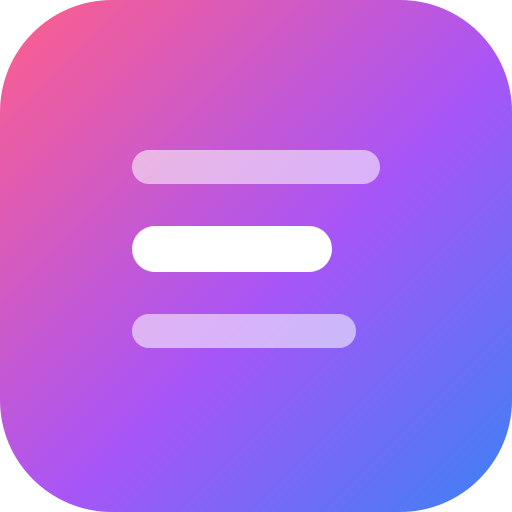
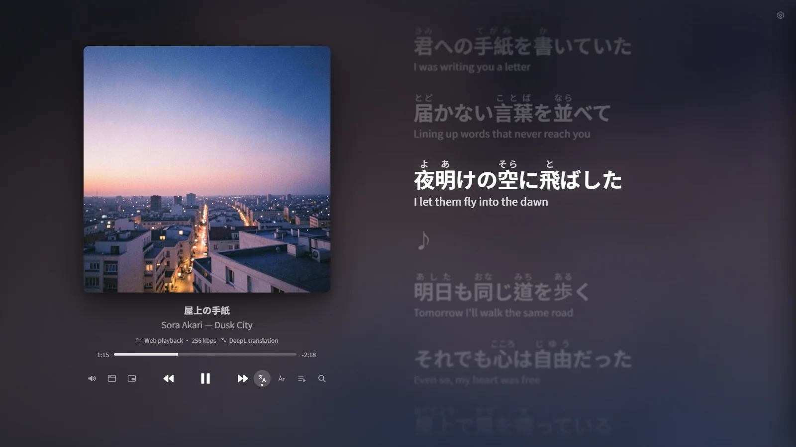
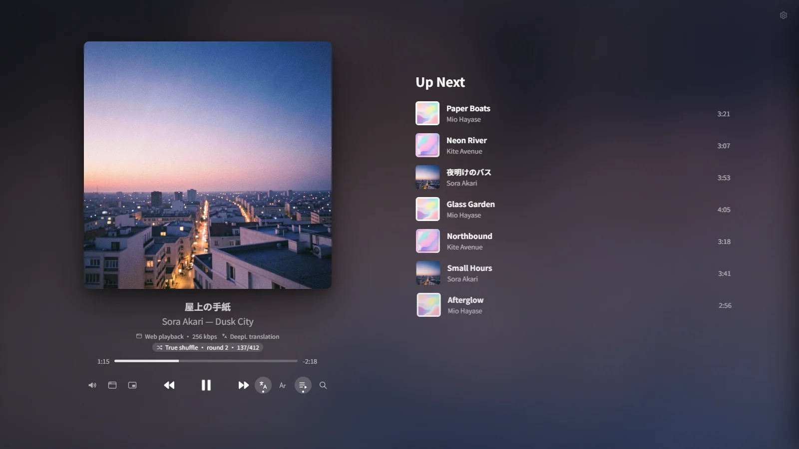
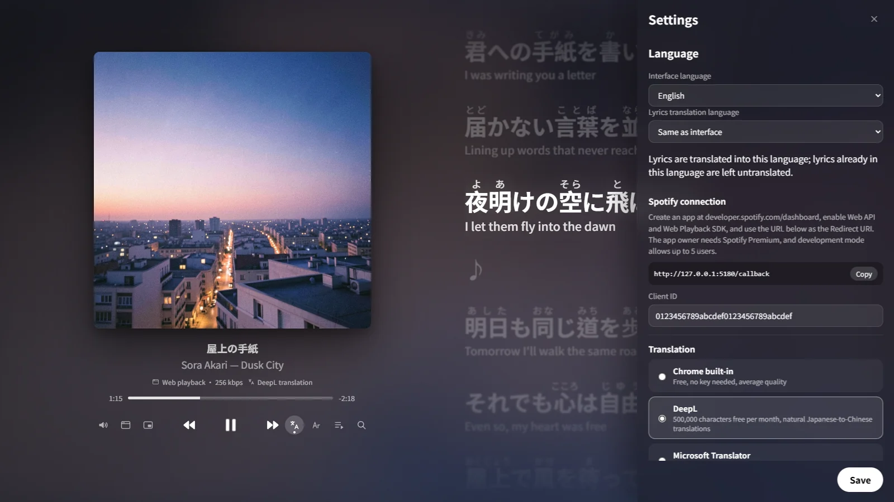

<p align="center">
  
</p>

<h1 align="center">Lyra</h1>

<p align="center">
  An Apple Music–style synced-lyrics player for Spotify<br/>
  Lyric translation · Furigana · True Shuffle · Floating lyrics
</p>

<p align="center">
  <b>English</b> · <a href="README.zh-TW.md">繁體中文</a>
</p>

<p align="center">
  
</p>

---

## Features

- **Apple Music–style Now Playing screen.** It has a large cover and a fluid, liquid-like background generated from the album art. Lyrics scroll in a springy wave.
- **Synced lyrics** come from the community database [LRCLIB](https://lrclib.net).
  - Fuzzy matching finds songs even when the artist name or title differs, for example 米津玄師 vs. Kenshi Yonezu, or a "Remastered" suffix.
  - If nothing matches, you can search manually. Lyra remembers your pick for that song.
- **Line-by-line translation** into your language. You choose the engine:
  - Chrome's built-in Translator: free, no key needed, used by default.
  - DeepL
  - Microsoft Translator
  - Any OpenAI-compatible LLM, such as OpenAI, Gemini, Ollama or LM Studio.

  Translations are cached on disk, so a song is never translated twice. Lines already in your language are skipped.
- **Japanese furigana** above kanji, with optional romaji.
- **True Shuffle.** Every song plays exactly once before the deck is reshuffled. Your progress is saved, so it continues across restarts and days.
- **Floating lyrics window** that stays on top of all your other windows.
- **Two playback modes:**
  - Play in the browser.
  - Remote-control the Spotify desktop app. Audio stays at 320 kbps or lossless, and Lyra only shows the lyrics.
- **Interface in 6 languages:** English, 繁體中文, 简体中文, 日本語, 한국어 and Español. The language you choose is also the default translation language.
- Up Next queue, search, playlists and Liked Songs. Narrow windows switch to a mini player automatically.

## Screenshots

| Up Next queue and True Shuffle progress | Settings: language, Spotify connection and translation engine |
|---|---|
|  |  |

<p align="center">
  <br/>
  <sub>Mini player for narrow windows</sub>
</p>

<sub>Demo song, lyrics and cover art are original, made for these screenshots.</sub>

## Requirements

- **Spotify Premium.** Spotify requires the owner of a developer app to have Premium.
- [Node.js](https://nodejs.org) 20 or newer.
- **Google Chrome.** Browser playback, the built-in translator and the floating lyrics window all need it.

## Getting started

### 1. Create your own Spotify app (about 3 minutes)

1. Open the [Spotify Developer Dashboard](https://developer.spotify.com/dashboard) and click **Create app**.
2. Set the **Redirect URI** to exactly:
   ```
   http://127.0.0.1:5180/callback
   ```
3. Tick **Web API** and **Web Playback SDK**.
4. Copy the **Client ID**. You don't need the Client Secret, so never share it.

> A Spotify app in Development Mode allows at most 5 users. Using your own Client ID avoids that limit.

### 2. Download and run

```bash
git clone https://github.com/mokeytimting/lyra-spotify-lyrics.git
cd lyra-spotify-lyrics
```

- **Windows:** double-click `start.bat`.
- **macOS:** double-click `start.command`. The first time, you may need to allow it in System Settings → Privacy & Security.
- **Linux:** run `./start.sh`.

The launcher installs dependencies, starts the local server and opens Lyra in a Chrome app window.
You can also run `npm install` and `npm start` yourself, then open http://127.0.0.1:5180. Use `127.0.0.1`, not `localhost`.

The first time you open Lyra, a setup screen appears. Paste your Client ID, pick a language and a translation engine, then log in with Spotify.

> **Just want a look?** Open http://127.0.0.1:5180/?demo to see the interface with a demo song, no Spotify login needed.

> To get Lyra into your Start menu or Dock, open it in Chrome and click the **Install** icon in the address bar. The local server still needs to be running.

## Translation engines

Click the gear icon in the top-right corner to switch engines, paste keys and **Test translation**.

| Engine | Key | Free tier (check each provider) | Notes |
|---|---|---|---|
| Chrome built-in | Not needed | Unlimited | Runs on your device. A language model downloads on first use. |
| [DeepL](https://www.deepl.com/pro-api) | Required | 500,000 chars / month | Very natural, especially for Japanese |
| [Microsoft Translator](https://learn.microsoft.com/azure/ai-services/translator/) | Required | 2,000,000 chars / month | Needs an Azure account. Set the region your resource uses. |
| LLM (OpenAI-compatible) | Depends | Depends | Understands the whole song, so it gives the most poetic results. Use `http://localhost:11434/v1` as the Base URL for a local Ollama. |

If your chosen engine fails or runs out of quota, Lyra falls back to Chrome's built-in translator.

**Your keys never leave your machine.** They are stored only in `data/settings.json`, which git ignores. The local server proxies every request, so keys never reach the browser. The server only accepts requests from Lyra's own page.

## Keyboard shortcuts

| Key | Action |
|---|---|
| `Space` | Play / pause |
| `/` | Open search |
| `]` / `[` | Show lyrics 0.1 s earlier / later |
| `\` | Reset lyrics timing |
| `Esc` | Close panels |

## Known limitations

Spotify has restricted Development Mode apps since 2026:

- True Shuffle works on **Liked Songs** and **playlists you own or collaborate on**. Spotify doesn't let third-party apps read tracks in other people's playlists.
- Search returns up to 10 results at a time. Scroll down to load more.
- Browser playback is capped at about 256 kbps. Switch to **App playback** for full quality.
- Lyrics come from a community database, so less popular songs may not have synced lyrics.

## Development

```bash
npm install
npm run dev        # http://127.0.0.1:5180
npm test           # unit tests
npm run typecheck
```

| Folder | Contents |
|---|---|
| `server/` | Local API, served as Vite plugins: settings, translation proxy, caches, request guard |
| `src/spotify/` | PKCE login and the Web API client |
| `src/playback/` | Browser player, app remote control, playback clock |
| `src/lyrics/` | LRC parsing and LRCLIB lookup |
| `src/translate/` | Translation pipeline |
| `src/text/` | Language detection, Chinese script conversion, furigana |
| `src/shuffle/` | True Shuffle |
| `src/i18n/` | Interface languages |
| `src/ui/` | Screens |

Translations of the interface live next to each screen, in `defineStrings({...})` tables. Pull requests that improve them are welcome.

## Disclaimer

- Lyra is not affiliated with or endorsed by Spotify. Spotify is a trademark of Spotify AB.
- Playback and track data come from the [Spotify Web API](https://developer.spotify.com/documentation/web-api), subject to the [Spotify Developer Terms](https://developer.spotify.com/terms).
- Lyrics are provided by the [LRCLIB](https://lrclib.net) community.
- See [THIRD_PARTY_NOTICES.md](THIRD_PARTY_NOTICES.md) for third-party licenses.

## License

[MIT](LICENSE)
