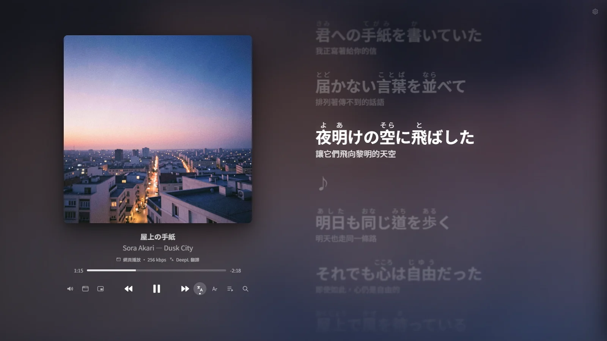
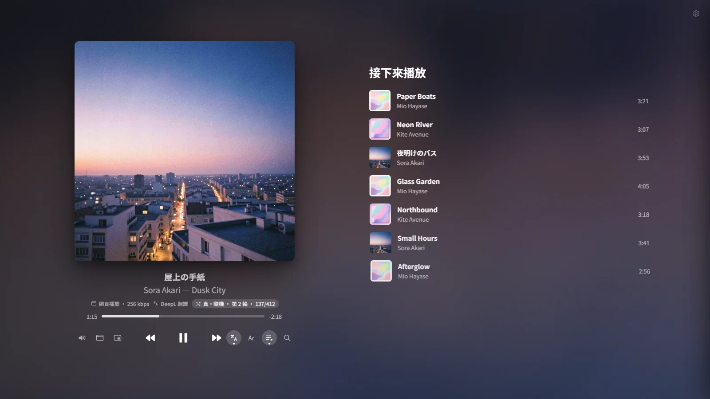
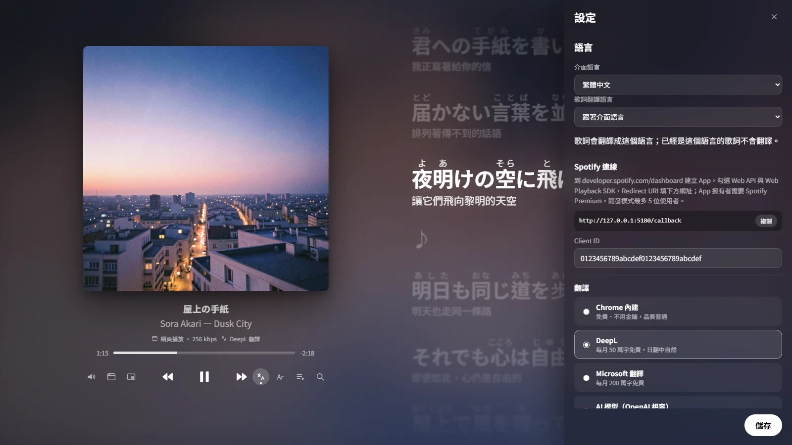
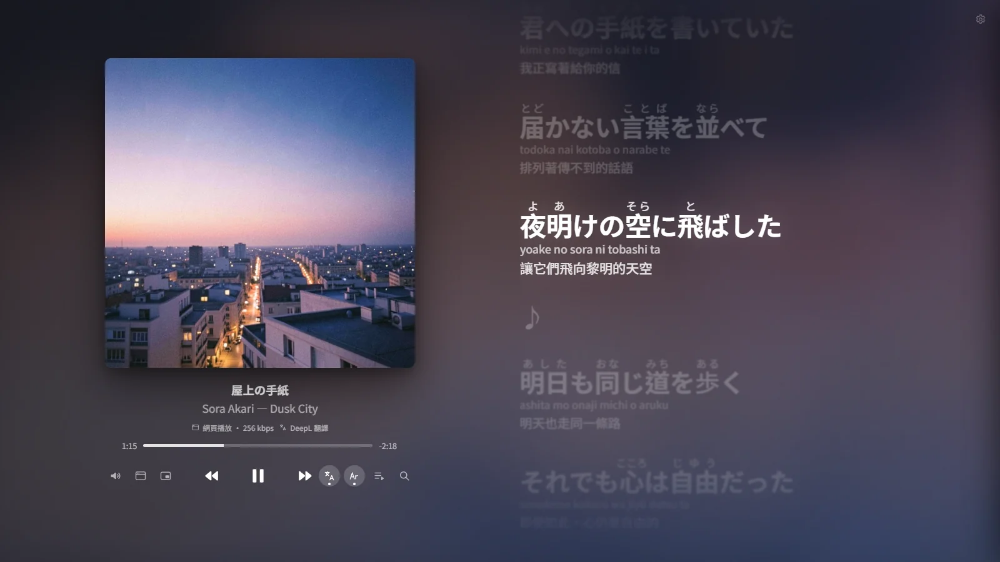
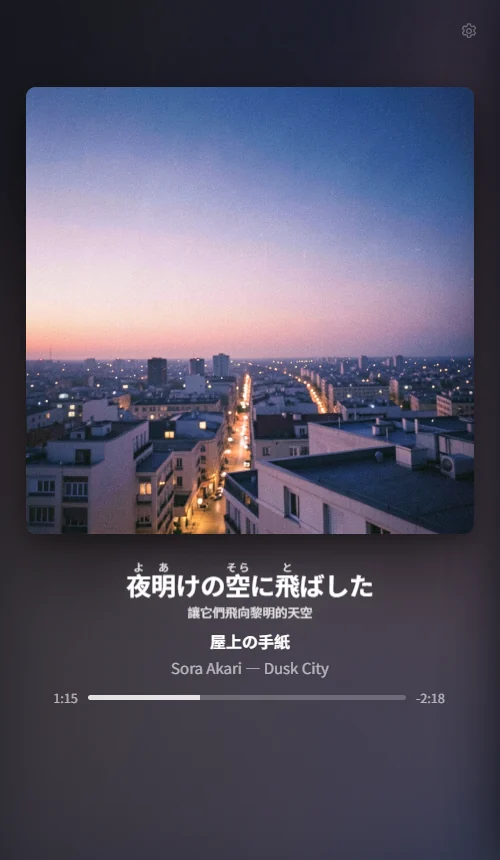

<p align="center">
  
</p>

<h1 align="center">Lyra</h1>

<p align="center">
  Apple Music 風格的 Spotify 同步歌詞播放器<br/>
  歌詞翻譯 · 日文假名標音 · 真・隨機播放 · 浮動歌詞視窗
</p>

<p align="center">
  <a href="README.md">English</a> · <b>繁體中文</b>
</p>

<p align="center">
  
</p>

---

## 特色

- **Apple Music 風格的正在播放畫面**：大封面、像液體一樣流動的背景（取自專輯封面）、彈簧波浪式的歌詞捲動。
- **同步歌詞**：來自社群歌詞資料庫 [LRCLIB](https://lrclib.net)。
  - 會用多種方式比對，例如歌手名稱不同（米津玄師／Kenshi Yonezu）、歌名有版本說明時也找得到。
  - 真的找不到時，可以手動搜尋並指定，之後會記住。
- **逐行翻譯成你的語言**，翻譯引擎可自選：
  - Chrome 內建翻譯：免費、不用金鑰，預設使用
  - DeepL
  - Microsoft 翻譯
  - AI 模型（OpenAI 相容格式：OpenAI、Gemini、Ollama、LM Studio 等）

  翻過的結果存在本機，同一首歌不會重複翻譯；已經是你的語言的歌詞會略過。
- **日文假名標音**，羅馬拼音可另外開關。中文歌詞會依你選的語言統一成繁體或簡體。
- **真・隨機播放**：像洗牌一樣，整份清單每首歌都播過一次才重新洗牌。播到哪裡會記住，關掉重開、隔天再聽都能接著播。
- **浮動歌詞視窗**：歌詞浮在所有視窗最上層，可以一邊工作一邊看。
- **兩種播放模式**
  - 網頁播放：瀏覽器本身就是播放器。
  - App 播放：聲音由 Spotify 電腦版發出，保留 320 kbps 或無損音質；Lyra 只顯示歌詞，並當作遙控器。
- **介面支援 6 種語言**：繁體中文、简体中文、English、日本語、한국어、Español。你選的介面語言也會是預設的翻譯語言。
- 待播清單、搜尋、歌單、已按讚的歌曲；視窗縮窄時自動變成迷你播放器。

## 截圖

| 待播清單與真・隨機播放進度 | 設定：語言、Spotify 連線與翻譯引擎 |
|---|---|
|  |  |

<p align="center">
  <br/>
  <sub>假名標音、羅馬拼音與翻譯同時顯示（用「Ar」按鈕開關羅馬拼音）</sub>
</p>

<p align="center">
  <br/>
  <sub>窄視窗時的迷你播放器</sub>
</p>

<sub>示範用的歌曲、歌詞與封面都是為了截圖原創的。</sub>

## 需要準備

- **Spotify Premium**（Spotify 規定：開發者 App 的擁有者必須是 Premium）
- [Node.js](https://nodejs.org) 20 以上
- **Google Chrome**（網頁播放、Chrome 內建翻譯、浮動歌詞視窗都需要）

## 開始使用

### 1. 建立你自己的 Spotify App（約 3 分鐘）

1. 到 [Spotify Developer Dashboard](https://developer.spotify.com/dashboard) 按 **Create app**。
2. **Redirect URI** 填入以下網址，要一字不差：
   ```
   http://127.0.0.1:5180/callback
   ```
3. 勾選 **Web API** 和 **Web Playback SDK**。
4. 複製 **Client ID**。不需要 Client Secret，也請不要把它給任何人。

> 開發模式的 Spotify App 最多只能有 5 位使用者。每個人用自己的 Client ID 就沒有這個問題。

### 2. 下載並啟動

```bash
git clone https://github.com/mokeytimting/lyra-spotify-lyrics.git
cd lyra-spotify-lyrics
```

- **Windows**：雙擊 `start.bat`
- **macOS**：雙擊 `start.command`（第一次執行可能需要在「系統設定 → 隱私權與安全性」允許）
- **Linux**：執行 `./start.sh`

啟動器會自動安裝套件、啟動本機伺服器，並用 Chrome 的「應用程式視窗」打開。
也可以手動執行 `npm install` 和 `npm start`，再打開 http://127.0.0.1:5180 。網址請用 `127.0.0.1`，不要用 `localhost`。

第一次打開會出現設定畫面：貼上 Client ID、選擇語言和翻譯引擎，然後登入 Spotify 就完成了。

> **只想先看看？** 打開 http://127.0.0.1:5180/?demo ，不用登入 Spotify 就能用示範歌曲看介面。

> 想讓它像一般 App 一樣出現在開始選單或 Dock：在 Chrome 打開後，按網址列右邊的「安裝」圖示。安裝後仍需要先啟動本機伺服器。

## 翻譯引擎

右上角的齒輪可以切換引擎、貼上金鑰，並按「測試翻譯」確認能不能用。

| 引擎 | 金鑰 | 免費額度（以各家官網為準） | 說明 |
|---|---|---|---|
| Chrome 內建 | 不需要 | 無限 | 在你的電腦上翻譯，第一次使用會下載語言模型 |
| [DeepL](https://www.deepl.com/pro-api) | 需要 | 每月 50 萬字 | 翻譯很自然，日文尤其好 |
| [Microsoft 翻譯](https://learn.microsoft.com/azure/ai-services/translator/) | 需要 | 每月 200 萬字 | 需要 Azure 帳號；「區域」依你建立資源時的設定填寫 |
| AI 模型（OpenAI 相容） | 視服務而定 | 視服務而定 | 會看懂整首歌的上下文，翻得最有意境；Base URL 填 `http://localhost:11434/v1` 可以使用本機的 Ollama |

選定的引擎失敗或額度用完時，會自動改用 Chrome 內建翻譯。

**金鑰不會離開你的電腦**：只存在 `data/settings.json`（不會進 git），所有請求都由本機伺服器轉送，金鑰不會傳到瀏覽器。本機伺服器也只接受 Lyra 自己頁面送出的請求。

## 鍵盤快捷鍵

| 按鍵 | 功能 |
|---|---|
| `空白鍵` | 播放／暫停 |
| `/` | 打開搜尋 |
| `]` / `[` | 歌詞提早／延後 0.1 秒 |
| `\` | 歌詞時間恢復預設 |
| `Esc` | 關閉面板 |

## 已知限制

這些都是 Spotify 2026 年起對開發模式 App 的限制：

- 真・隨機播放只能用在「已按讚的歌曲」和**自己建立或共同編輯的歌單**。別人的歌單，Spotify 不讓第三方讀取曲目。
- 搜尋每次最多 10 筆，捲到底會自動載入更多。
- 網頁播放的音質上限約 256 kbps。需要更高音質請切換到「App 播放」。
- 歌詞來自社群資料庫，冷門歌曲可能沒有同步歌詞。

## 開發

```bash
npm install
npm run dev        # http://127.0.0.1:5180
npm test           # 單元測試
npm run typecheck
```

| 資料夾 | 內容 |
|---|---|
| `server/` | 本機 API，以 Vite plugin 形式提供：設定、翻譯轉送、快取、請求防護 |
| `src/spotify/` | PKCE 登入與 Web API |
| `src/playback/` | 網頁播放、App 遙控、播放時鐘 |
| `src/lyrics/` | LRC 解析與 LRCLIB 查詢 |
| `src/translate/` | 翻譯流程 |
| `src/text/` | 語言判斷、繁簡轉換、假名 |
| `src/shuffle/` | 真・隨機播放 |
| `src/i18n/` | 介面語言 |
| `src/ui/` | 畫面 |

介面的翻譯放在各畫面檔案的 `defineStrings({...})` 字串表中，歡迎送 PR 改進。

## 聲明

- 本專案與 Spotify 無關，也未經 Spotify 背書。Spotify 是 Spotify AB 的商標。
- 播放與歌曲資訊透過 [Spotify Web API](https://developer.spotify.com/documentation/web-api) 取得，使用時須遵守 Spotify 的[開發者條款](https://developer.spotify.com/terms)。
- 歌詞由 [LRCLIB](https://lrclib.net) 社群提供。
- 第三方套件授權見 [THIRD_PARTY_NOTICES.md](THIRD_PARTY_NOTICES.md)。

## 授權

[MIT](LICENSE)
